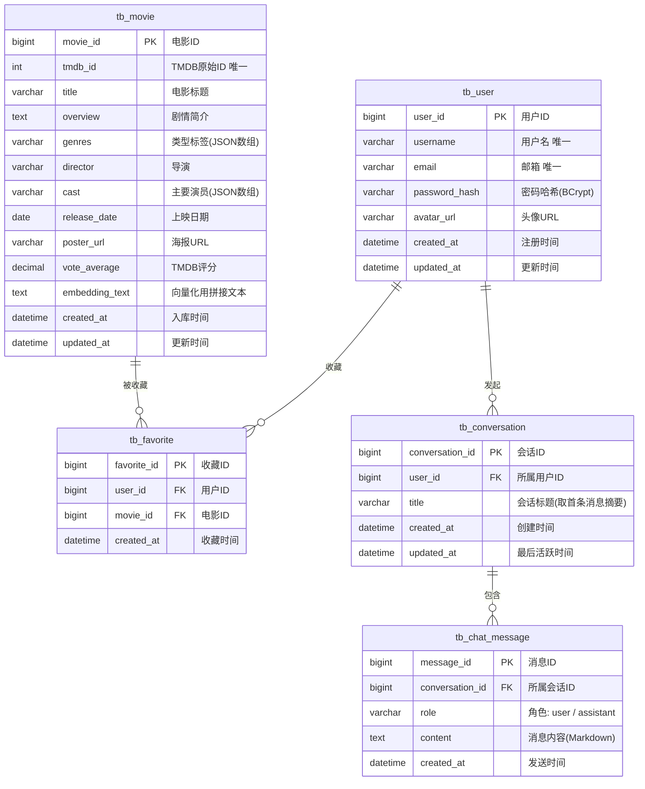
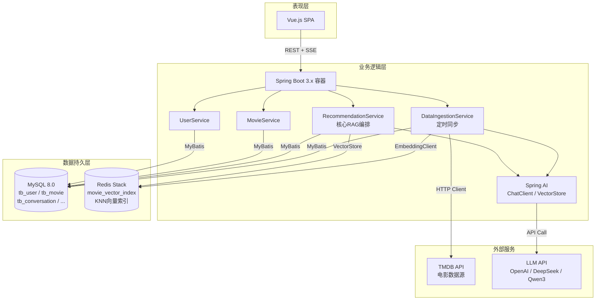
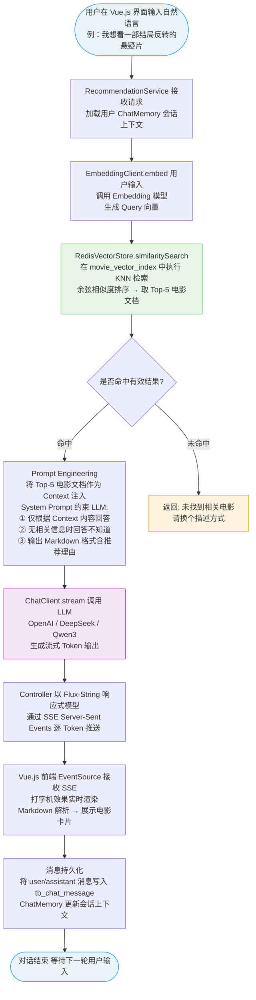

# 基于大语言模型的电影推荐系统 — 设计文档

---

## 一、项目简介

本项目题目为**《基于大语言模型的电影推荐系统设计与实现》**，旨在解决传统推荐系统"信息过载"、"冷启动"和"黑盒不可解释"等痛点。

系统以 **RAG（检索增强生成）** 架构为核心，通过 TMDB API 构建本地电影知识库，将电影文本向量化后存入 Redis Stack，用户以自然语言提问，系统语义检索后将上下文注入 LLM，由大模型生成带推荐理由的回答，并通过 SSE 流式返回前端，体验类似 ChatGPT 的对话推荐。

**核心技术栈：** Spring Boot 3.x + MyBatis + Spring AI + MySQL 8.0 + Redis Stack + Vue.js

**数据规模目标：** ≥ 5000 部电影，向量检索 < 50ms，首字响应（TTFT）< 2s

---

## 二、需求分析

### 2.1 功能性需求

#### 用户模块
| 编号 | 需求描述 |
|------|---------|
| F-U-01 | 用户注册，填写用户名、邮箱、密码，系统返回注册结果 |
| F-U-02 | 用户登录，支持用户名/邮箱 + 密码登录，返回 JWT Token |
| F-U-03 | 用户可查看、修改个人信息（昵称、头像等） |
| F-U-04 | 用户可退出登录，服务端使 Token 失效 |

#### 对话推荐模块
| 编号 | 需求描述 |
|------|---------|
| F-R-01 | 用户以自然语言输入查询（如"推荐一部90年代的科幻片"），系统返回相关电影推荐及理由 |
| F-R-02 | 系统支持多轮对话，能够理解上下文（如"再推荐一部类似的"） |
| F-R-03 | 回复以 SSE 流式逐字输出，前端打字机效果呈现 |
| F-R-04 | 推荐结果附带电影卡片（海报、评分、简介摘要、详情链接） |
| F-R-05 | 用户可对推荐结果进行收藏，保存至收藏列表 |

#### 历史记录模块
| 编号 | 需求描述 |
|------|---------|
| F-H-01 | 每次对话自动创建会话（Conversation），用户可查看历史会话列表 |
| F-H-02 | 用户可点击历史会话，恢复并继续该会话的上下文 |
| F-H-03 | 用户可删除指定历史会话及其所有消息 |

#### 数据管理模块（后台/定时任务）
| 编号 | 需求描述 |
|------|---------|
| F-D-01 | 系统通过 TMDB API 采集 ≥ 5000 部电影元数据并入库 MySQL |
| F-D-02 | 采集完成后自动对电影文本进行 Embedding，写入 Redis 向量索引 |
| F-D-03 | 支持每日增量更新（新上映电影自动同步） |
| F-D-04 | MySQL 数据更新时，异步触发 Redis 向量索引同步更新 |

---

### 2.2 非功能性需求

| 类别 | 需求描述 | 指标 |
|------|---------|------|
| **性能** | 向量检索耗时 | ≤ 50ms |
| **性能** | 首字生成响应时间（TTFT） | ≤ 2s |
| **性能** | 系统支持并发用户 | ≥ 50 并发 |
| **准确性** | 推荐结果真实存在，杜绝 LLM 幻觉 | RAG 约束下无虚构电影 |
| **可扩展性** | 向量数据库可替换（通过 Spring AI VectorStore 接口抽象） | 接口解耦 |
| **可扩展性** | LLM 供应商可切换（OpenAI / DeepSeek / Qwen3） | 配置文件驱动 |
| **安全性** | API 接口鉴权，防止未登录访问 | JWT + Spring Security |
| **安全性** | 用户密码加密存储 | BCrypt 哈希 |
| **可靠性** | MySQL 与 Redis 数据最终一致 | Spring Event 异步同步 |
| **可用性** | 系统 7×24 小时可用，异常自动恢复 | — |
| **易用性** | 支持 Markdown 渲染，界面清晰直观 | — |

---

## 三、ER 图

> 除报告中提及的 `tb_user`、`tb_movie` 外，补充了 `tb_favorite`（收藏）、`tb_conversation`（对话会话）、`tb_chat_message`（聊天消息）三张表，共同支撑系统核心业务。



> **Redis 向量索引（非关系型，不在 ER 图中体现）：**
> Key 格式 `movie_vector:{tmdb_id}`，存储字段包括 `embedding`（768/1536 维浮点向量）及 `movie_id` 关联回 MySQL。索引名 `movie_vector_index`，检索算法 KNN，距离度量 Cosine。

---

## 四、系统架构

### 4.1 三层架构说明

系统采用经典的**前后端分离三层架构**：

**表现层（Presentation Layer）**

- Vue.js 单页面应用（SPA），构建对话推荐界面
- 通过 HTTP REST API 与后端通信，推荐回复通过 SSE 长连接接收流式数据
- 集成 `marked.js` 进行 Markdown 渲染，展示电影卡片

**业务逻辑层（Business Logic Layer）**

- Spring Boot 3.x 容器，统一管理 Bean 生命周期与依赖注入
- `UserService`：处理注册、登录、JWT 签发与鉴权
- `MovieService`：处理电影信息的 CRUD 及 TMDB 数据同步
- `RecommendationService`：**核心服务**，编排 RAG 完整流程（Embedding → 向量检索 → Prompt 构建 → LLM 调用 → SSE 返回）
- `DataIngestionService`：定时任务（@Scheduled），驱动全量/增量数据采集与向量化
- Spring AI `ChatMemory`：维护多轮对话上下文的内存/持久化会话

**数据持久层（Data Access Layer）**

- **MySQL 8.0**：存储结构化业务数据（用户、电影元数据、收藏、对话历史）；MyBatis 负责 ORM 映射
- **Redis Stack**：存储电影向量索引，提供 KNN 相似度检索；Spring AI `RedisVectorStore` 封装操作细节

---

### 4.2 三层架构总览图



---

## 五、RAG 流程图

> 完整描述：用户输入 → Embedding → Redis 向量检索 → Prompt 注入 → LLM → SSE 流式返回



---

## 六、技术栈说明

```
后端语言：Java 17
核心框架：Spring Boot 3.2 + MyBatis 3.5 + Spring AI 1.x
关系型库：MySQL 8.0
向量数据库：Redis Stack（RediSearch 模块）
前端框架：Vue 3 + Vite + Element Plus 
Embedding：Qwen3-Embedding
LLM：DeepSeek-V3 可配置切换
流式通信：SSE + Reactor Flux<String>
构建工具：Maven
```
